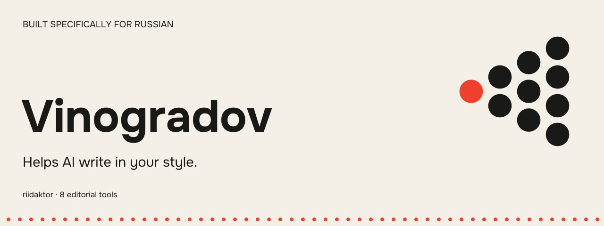
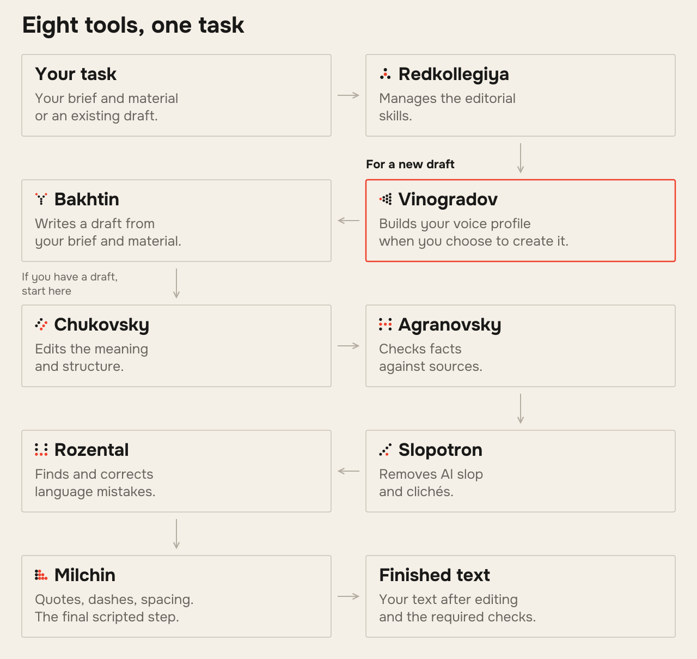

[Русский](README.md) · [English](README.en.md)

<picture>
  <source media="(prefers-color-scheme: dark)" srcset="assets/brand/cover-en-dark.svg">
  
</picture>

# Vinogradov

**Built specifically for Russian.** Helps AI write in your style by analysing your texts and building an author voice profile.

[How to install](#how-to-install) · [Example tasks](#example-tasks)

## How it works

Give Vinogradov several texts you have written. It studies your word choices, sentences and ways of explaining ideas, then describes your style with examples. You can give this description to AI to help it write more like you. If you do not want to build your own voice profile, ask Vinogradov to use the neutral voice — it works well too.


## Example tasks

### Build your voice profile

> Use Vinogradov to analyse my texts and build an author voice profile. Separate stable stylistic choices from topic-specific features. Tell me if the sample is insufficient.

### Understand your writing style

> Analyse how my texts introduce an idea, explain difficult subjects, use examples and end. Support the observations with short excerpts from the corpus.

### Refine a profile

> Use these new texts to refine my voice profile. Show which features are confirmed and which need revision. Do not blend different authors into a single voice.


## How to install

### For agents

Claude Code, Codex / ChatGPT Desktop, Cursor, GitHub Copilot, Gemini CLI — give your agent this instruction:

```text
Install the Vinogradov skill:
https://github.com/beaverbeard/vinogradov

Use it whenever we write or edit texts.
```

<details>
<summary>More options</summary>

Agent-specific setup: [Claude Code](docs/OTHER-APPS.en.md#claude-code), [ChatGPT Desktop / Codex](docs/OTHER-APPS.en.md#codex), [Cursor](docs/OTHER-APPS.en.md#cursor), [GitHub Copilot](docs/OTHER-APPS.en.md#copilot), [Gemini CLI](docs/OTHER-APPS.en.md#gemini-cli).

### ChatGPT, Claude or Gemini in a browser

Download [this skill’s package](docs/downloads/vinogradov.zip). It includes the instructions, scripts and resources.

- **ChatGPT:** create a project and add the instructions and resources from the extracted package. [Step by step](docs/OTHER-APPS.en.md#chatgpt).
- **Claude:** enable code execution and upload the ZIP in Customize → Skills. [Step by step](docs/OTHER-APPS.en.md#claude).
- **Gemini:** open Customize → Skills → Create → Upload and upload the package. [Step by step](docs/OTHER-APPS.en.md#gemini).

Available stages depend on the tools in your app. [Check readiness](docs/OTHER-APPS.en.md#readiness).

### Better still: the whole Redkollegiya toolkit

Install [Redkollegiya](https://github.com/beaverbeard/redkollegiya) with all eight skills. It selects the tools for writing, editing and proofreading. Give your agent this instruction:

```text
Install Redkollegiya and the complete set of eight editorial skills:
https://github.com/beaverbeard/redkollegiya

Use them whenever we write or edit texts.
```

</details>


## When your input is needed

Vinogradov asks for clarification if the corpus is too small or mixes authors. A profile describes your style; it does not add someone else’s experience or biography.

## Inside the toolkit

Vinogradov handles one part of the writing workflow. Start with [Redkollegiya](https://github.com/beaverbeard/redkollegiya) for the complete process; it selects the tools for the task.

<picture>
  <source media="(prefers-color-scheme: dark) and (max-width: 600px)" srcset="assets/brand/system-map-en-dark-narrow.svg">
  <source media="(prefers-color-scheme: dark)" srcset="assets/brand/system-map-en-dark.svg">
  <source media="(max-width: 600px)" srcset="assets/brand/system-map-en-light-narrow.svg">
  
</picture>

These eight skills make up the writing toolkit. Below are their responsibilities and links to their repositories.

| Skill | What it helps you do |
|---|---|
| [Редколлегия / Redkollegiya](https://github.com/beaverbeard/redkollegiya) | Writes and edits texts, from the first draft through fact-checking and final proofreading. |
| [Виноградов / Vinogradov](https://github.com/beaverbeard/vinogradov) | Helps AI write in your style by analysing your texts and building an author voice profile. |
| [Бахтин / Bakhtin](https://github.com/beaverbeard/bakhtin) | Writes posts, emails and articles from your brief and material in the style you need. |
| [Чуковский / Chukovsky](https://github.com/beaverbeard/chukovsky) | Edits texts by improving structure, fixing gaps in logic and removing bureaucratic wording. |
| [Аграновский / Agranovsky](https://github.com/beaverbeard/agranovsky) | A fact-checking skill for texts. Checks numbers, dates, quotes and links, and shows sources. |
| [Слопотрон / Slopotron](https://github.com/beaverbeard/slopotron) | Clears out the AI slop and clichés everyone is sick of. |
| [Розенталь / Rozental](https://github.com/beaverbeard/rozental) | A proofreading skill: checks and corrects texts. Finds mistakes in spelling, punctuation and grammar. |
| [Мильчин / Milchin](https://github.com/beaverbeard/milchin) | A typography skill: formats text to Russian typesetting rules. Checks quotes, dashes and spacing. |

## The riidaktor newsletter

In riidaktor, we explore how to write and edit texts with AI.

Learn to give clearer briefs, retain your own voice and spot invented details. Take the techniques into your workflow to spend less time reworking drafts and publish with more confidence.

[Subscribe to the newsletter →](https://redaktozavr.ru/rAIdactor?utm_source=skills)


## The person behind the name


**Viktor Vladimirovich Vinogradov (1894–1969)**

Viktor Vinogradov was a linguist and literary scholar who studied how a distinctive authorial style takes shape in a text. His concept of the ‘image of the author’ helps explain why writing is recognisable through its vocabulary, tone and narrative structure, as well as its plot. It connects individual choices into an overall style. We named this skill after him because it analyses your writing and builds a voice profile that helps AI write in your style.

<br clear="all">

Photo: Vsevolod Tarasevich · [source and terms](assets/people/CREDITS.md).

## Compatibility and source

Check the tools available in your app when setting up. The English page translates the documentation.

[SKILL.md](https://github.com/beaverbeard/vinogradov/blob/ea9b87925e59c69425d9a1cb911f0d3c57e6e6cd/SKILL.md) · [MIT](https://github.com/beaverbeard/vinogradov/blob/ea9b87925e59c69425d9a1cb911f0d3c57e6e6cd/LICENSE)
