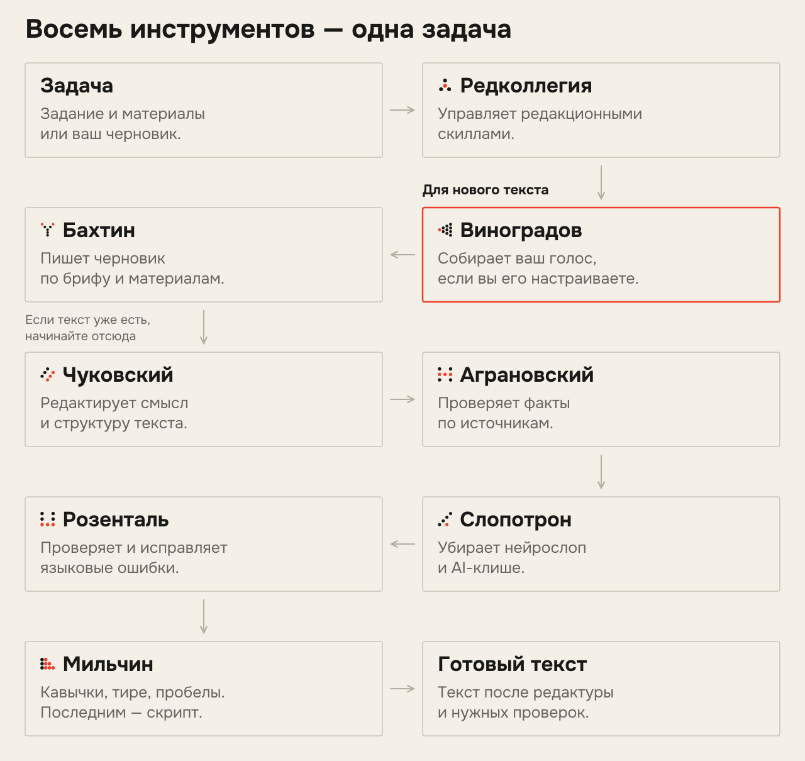

[Русский](README.md) · [English](README.en.md)

<picture>
  <source media="(prefers-color-scheme: dark)" srcset="assets/brand/cover-ru-dark.svg">
  
</picture>

# Виноградов

**Специально для русского языка.** Помогает ИИ писать в вашем стиле: изучает ваши тексты и собирает профиль авторского голоса.

[Как установить?](#как-установить) · [Примеры задач](#примеры-задач)

## Как это работает

Вы даёте несколько своих текстов. Виноградов изучает, какие слова вы выбираете, как строите фразы и объясняете мысли, и собирает описание вашего стиля с примерами. Это описание можно передать ИИ, чтобы он писал ближе к вашему стилю. Если не хотите собирать собственный голос, попросите Виноградова использовать нейтральный голос — он тоже хорош.


## Примеры задач

### Собрать свой голос

> Изучи эти мои тексты через Виноградова и собери профиль авторского голоса. Отдели устойчивые приёмы от особенностей темы. Если образцов мало, скажи, чего не хватает.

### Разобраться в своём стиле

> Разбери мои тексты: как я начинаю мысль, объясняю сложное, привожу примеры и заканчиваю. Покажи наблюдения на коротких фрагментах из корпуса.

### Уточнить профиль

> Добавь эти новые тексты к моему голосовому профилю. Покажи, какие признаки подтвердились, а какие требуют уточнения. Не смешивай разные авторские стили в один.


## Как установить?

### Для агентов

Claude Code, Codex / ChatGPT Desktop, Cursor, GitHub Copilot, Gemini CLI — отдайте агенту команду:

```text
Установи скилл «Виноградов»:
https://github.com/beaverbeard/vinogradov

Используй его, когда мы пишем или редактируем тексты.
```

<details>
<summary>Ещё варианты</summary>

Настройка для каждого агента: [Claude Code](docs/OTHER-APPS.ru.md#claude-code), [ChatGPT Desktop / Codex](docs/OTHER-APPS.ru.md#codex), [Cursor](docs/OTHER-APPS.ru.md#cursor), [GitHub Copilot](docs/OTHER-APPS.ru.md#copilot), [Gemini CLI](docs/OTHER-APPS.ru.md#gemini-cli).

### ChatGPT, Claude или Gemini в браузере

Скачайте [пакет этого скилла](docs/downloads/vinogradov.zip). Внутри — инструкции, скрипты и ресурсы.

- **ChatGPT:** создайте проект и добавьте инструкции и ресурсы из распакованного пакета. [По шагам](docs/OTHER-APPS.ru.md#chatgpt).
- **Claude:** включите выполнение кода и загрузите ZIP в Customize → Skills. [По шагам](docs/OTHER-APPS.ru.md#claude).
- **Gemini:** откройте Customize → Skills → Create → Upload и загрузите пакет. [По шагам](docs/OTHER-APPS.ru.md#gemini).

Доступные этапы зависят от инструментов приложения. [Как проверить готовность](docs/OTHER-APPS.ru.md#readiness).

### А лучше — вся Редколлегия

Установите [Редколлегию](https://github.com/beaverbeard/redkollegiya) вместе со всеми восемью скиллами: она подключит нужные инструменты для написания, редактуры и вычитки текста. Отдайте агенту команду:

```text
Установи Редколлегию и весь комплект из восьми редакционных скиллов:
https://github.com/beaverbeard/redkollegiya

Используй их, когда мы пишем или редактируем тексты.
```

</details>


## Когда понадобится ваше решение

Если в корпусе мало материала или смешаны разные авторы, Виноградов попросит уточнения. Профиль описывает ваш стиль; он не добавляет вам чужой опыт и биографию.

## Что внутри

Виноградов выполняет свою часть работы с текстом. Для полного процесса начните с [Редколлегии](https://github.com/beaverbeard/redkollegiya): она подключает нужные инструменты.

<picture>
  <source media="(prefers-color-scheme: dark) and (max-width: 600px)" srcset="assets/brand/system-map-ru-dark-narrow.svg">
  <source media="(prefers-color-scheme: dark)" srcset="assets/brand/system-map-ru-dark.svg">
  <source media="(max-width: 600px)" srcset="assets/brand/system-map-ru-light-narrow.svg">
  
</picture>

Вся система состоит из восьми скиллов. Ниже — задачи каждого и ссылки на их репозитории.

| Скилл | Чем поможет |
|---|---|
| [Редколлегия / Redkollegiya](https://github.com/beaverbeard/redkollegiya) | Пишет и редактирует тексты. Помогает пройти путь от первого черновика до проверки фактов и финальной вычитки. |
| [Виноградов / Vinogradov](https://github.com/beaverbeard/vinogradov) | Помогает ИИ писать в вашем стиле: изучает ваши тексты и собирает профиль авторского голоса. |
| [Бахтин / Bakhtin](https://github.com/beaverbeard/bakhtin) | Пишет посты, письма и статьи по вашему брифу и материалам, учитывая нужный стиль. |
| [Чуковский / Chukovsky](https://github.com/beaverbeard/chukovsky) | Редактирует тексты. Выстраивает мысль, исправляет провалы в логике и убирает канцелярит. |
| [Аграновский / Agranovsky](https://github.com/beaverbeard/agranovsky) | Скилл-фактчекер для текстов. Проверяет цифры, даты, цитаты и ссылки, показывает источники. |
| [Слопотрон / Slopotron](https://github.com/beaverbeard/slopotron) | Очищает тексты от нейрослопа и AI-клише, которые всех бесят. |
| [Розенталь / Rozental](https://github.com/beaverbeard/rozental) | Скилл-корректор: проверяет и исправляет тексты. Находит ошибки в орфографии, пунктуации и грамматике. |
| [Мильчин / Milchin](https://github.com/beaverbeard/milchin) | Скилл-типограф: приводит текст к нормам русской типографики. Проверяет и исправляет кавычки, тире и пробелы. |

## Рассылка «рИИдактор»

В «рИИдакторе» мы разбираем, как писать и редактировать тексты с ИИ.

Учимся давать понятные задания, сохранять свой голос и замечать то, что нейросеть придумала за вас. Берите приёмы в работу, чтобы тратить меньше времени на переделки и увереннее выпускать тексты.

[Подписаться на рассылку →](https://redaktozavr.ru/rAIdactor?utm_source=skills)


## Совместимость и исходники

При подключении проверьте доступные инструменты выбранного приложения. Английская страница содержит перевод документации.

[SKILL.md](https://github.com/beaverbeard/vinogradov/blob/ea9b87925e59c69425d9a1cb911f0d3c57e6e6cd/SKILL.md) · [MIT](https://github.com/beaverbeard/vinogradov/blob/ea9b87925e59c69425d9a1cb911f0d3c57e6e6cd/LICENSE)
